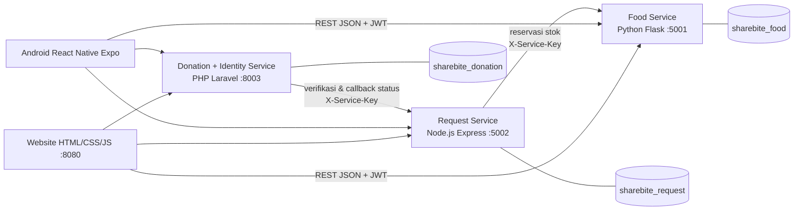

# Arsitektur ShareBite

ShareBite adalah platform berbagi makanan berlebih. Backend dipecah menjadi **tiga microservice** dengan bahasa berbeda dan **tiga database terpisah** pada satu server MySQL XAMPP.



| Service | Bahasa/Framework | Port | Database | Tanggung jawab |
|---|---|---|---|---|
| Food Service | Python 3 + Flask + SQLAlchemy | 5001 | `sharebite_food` | makanan, kategori, foto, stok, pencarian, reservasi stok |
| Request Service | Node.js + Express + mysql2 | 5002 | `sharebite_request` | permintaan, mesin status, riwayat, orkestrasi reservasi |
| Donation Service | PHP + Laravel | 8003 | `sharebite_donation` | registrasi, login, JWT, pengguna, donasi, jadwal, serah terima |

## Keputusan desain

1. **Autentikasi JWT RS256.** Hanya Donation Service memegang kunci privat dan menerbitkan token (berlaku 15 menit) plus refresh token opak (7 hari, disimpan sebagai hash SHA-256, dirotasi tiap dipakai). Food dan Request Service hanya memegang kunci publik sehingga dapat memverifikasi tanpa memanggil service lain, tetapi tidak dapat memalsukan token.
2. **Identitas dari token, bukan dari body.** `donor_id` / `recipient_id` selalu diambil dari klaim `sub`.
3. **Tidak ada foreign key lintas database.** ID antar-service hanya referensi nilai. Request Service menyimpan *snapshot* `food_title` dan `donor_id` agar daftar tidak perlu memanggil Food Service.
4. **Reservasi stok atomik.** Food Service mengurangi stok dengan satu `UPDATE ... WHERE quantity_available >= qty` dan mencatat reservasi pada transaksi yang sama. `request_id` bersifat unik sehingga pemanggilan ulang idempoten. Stok tidak mungkin negatif.
5. **Saga untuk membuat permintaan** (Request Service):
   `INSERT status=reserving` → `POST reservasi ke Food Service` → `UPDATE status=pending + snapshot`.
   Jika langkah 2 gagal, baris ditandai `failed` dan dapat dicoba ulang dengan `Idempotency-Key` yang sama. Jika langkah 3 gagal, stok dilepas (kompensasi). Baris `reserving` yang macet dibersihkan job rekonsiliasi.
6. **Satu permintaan aktif per (penerima, makanan)** ditegakkan database lewat unique key `(recipient_id, food_id, active_slot)`; `active_slot` bernilai 1 selama status aktif dan `NULL` setelah selesai. Klik ganda paralel tidak dapat menembus.
7. **Mesin status** (hanya Request Service yang mengubah status permintaan):

```
reserving → pending → approved → scheduled → completed
               │         │          │
               ├→ rejected          └→ cancelled
               ├→ cancelled   (dari approved: oleh penerima/donor/admin)
               └→ expired     (otomatis lewat 24 jam tanpa keputusan)
reserving → failed (internal, tidak tampil di daftar)
```

   Setiap transisi memakai `UPDATE ... WHERE status IN (...)` sehingga balapan dua aksi tidak menghasilkan status ganda. Setiap perubahan dicatat di `request_history`.
8. **Pelepasan stok yang tahan gangguan.** Saat ditolak/dibatalkan/kedaluwarsa, status berubah dulu, lalu stok dilepas. Jika Food Service sedang mati, kolom `stock_released` tetap 0 dan job rekonsiliasi (otomatis tiap 60 detik, atau `npm run reconcile`) mengulang sampai berhasil. Pelepasan idempoten.
9. **Callback Donation → Request.** Donation Service menjadwalkan donasi lalu memanggil `POST /internal/v1/requests/{id}/status`. Bila gagal, donasi diberi `sync_pending=1` dan dapat dikirim ulang dengan `php artisan donations:sync`.
10. **Endpoint internal** (`/internal/v1/*`) hanya menerima header `X-Service-Key` (dibandingkan *constant-time*), tidak dapat dipanggil dengan token pengguna.
11. **Waktu** selalu UTC (ISO 8601 dengan akhiran `Z`); klien menampilkan waktu lokal.
12. **Siap Docker:** semua konfigurasi dari environment variable, alamat service bukan hard-code, tiap service berdiri sendiri. (Dockerfile sengaja belum dibuat sesuai batas tugas.)

## Batasan yang disengaja
- Token akses yang sudah terbit tetap valid di Food/Request Service sampai kedaluwarsa (maks. 15 menit) walau akun dinonaktifkan; Donation Service langsung menolak. Refresh token pengguna nonaktif dicabut.
- Menonaktifkan donor tidak otomatis menutup makanan atau menolak permintaan miliknya (admin memutuskan manual).

---
## Tambahan v1.1: fitur sosial dan moderasi
- **Pemilik data:** notifikasi, favorit, laporan, audit, kampanye, dan poin berada di Donation Service (Laravel) karena terkait akun pengguna; tidak ada duplikasi tabel di service lain.
- **Notifikasi lintas service:** Request Service memanggil `POST /api/v1/internal/notifications` (X-Service-Key) saat ada permintaan baru, persetujuan, penolakan, pembatalan, atau kedaluwarsa. Panggilan bersifat *best effort* — kegagalan hanya dicatat dan tidak menggagalkan operasi utama. Donation Service membuat notifikasi donasi sendiri (jadwal, konfirmasi, selesai, batal, pengingat).
- **Audit log:** aksi admin di Donation Service dicatat langsung; aksi admin di Food/Request Service dikirim ke `POST /api/v1/internal/audit`. Meta dibersihkan dari kunci rahasia (password, token, secret, key).
- **Poin & statistik hanya dari donasi *selesai***; `donations.completed_at` dipakai untuk periode kampanye, peringkat bulanan, dan grafik.
- **Peta:** koordinat opsional di `foods`; jarak dihitung di database (haversine). Tampilan peta memakai Leaflet + OpenStreetMap, dengan fallback daftar alamat.
- **Pengingat pengambilan:** `php artisan donations:remind` (dijadwalkan tiap jam oleh `schedule:work`); satu kali per donasi (`reminded_at`).
- **Frontend:** tanpa framework/Bootstrap; satu design system (`css/style.css`), kerangka halaman (`js/shell.js`) menyediakan navbar publik, sidebar per peran, breadcrumb, guard peran, dan polling notifikasi.
